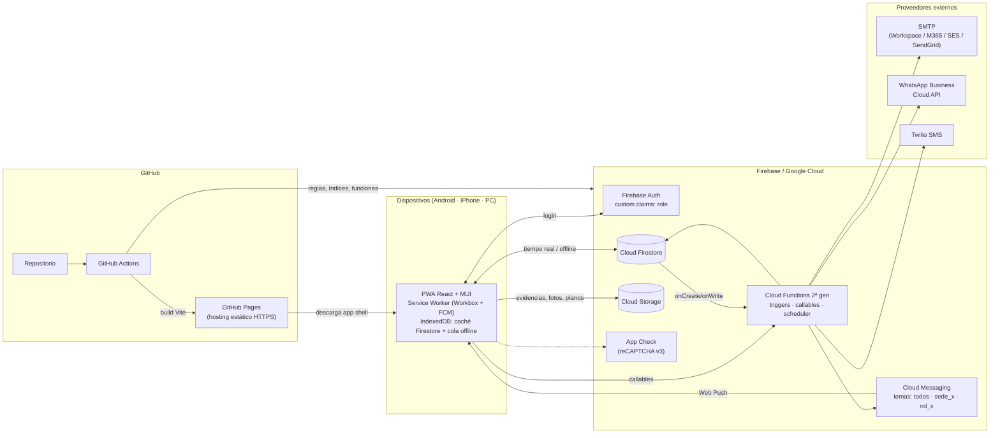
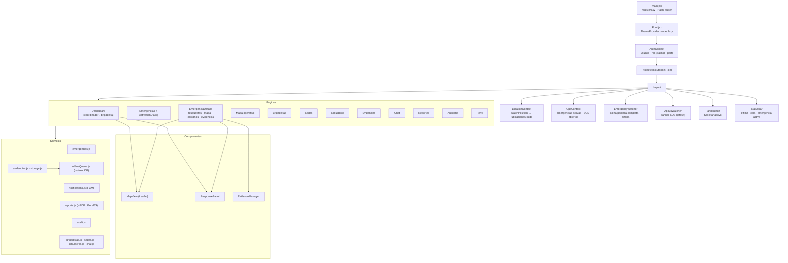
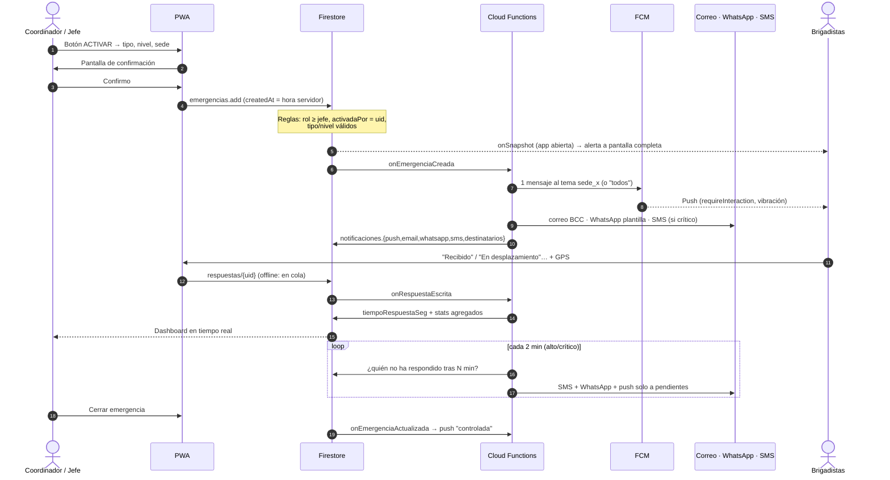
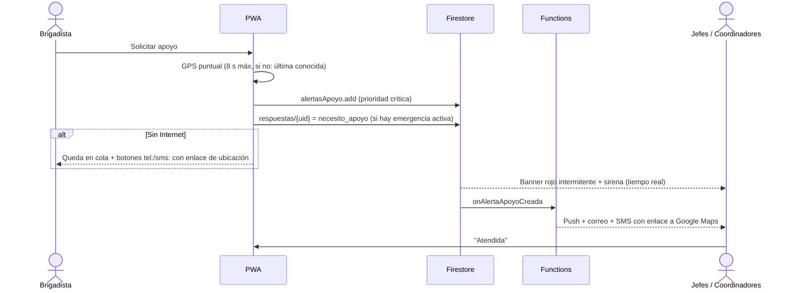

# Arquitectura

## 1. Visión general

Plataforma **serverless** compuesta por una PWA estática (React + Vite + Material UI) publicada en **GitHub Pages** y un backend administrado en **Firebase** (Auth, Firestore, Storage, Cloud Messaging y Cloud Functions 2.ª gen.).

Principios de diseño para un sistema de notificación crítica:

| Principio | Cómo se aplica |
|---|---|
| **Redundancia de alerta** | Una activación llega por 5 vías independientes: listener en tiempo real de Firestore (alerta a pantalla completa con sirena), push FCM, correo, WhatsApp y SMS. Si nadie responde en N minutos (niveles alto/crítico) se **escala** por SMS/WhatsApp solo a quienes no respondieron. |
| **Offline-first** | Service Worker con precache del app shell, caché de teselas y archivos; Firestore con caché persistente en IndexedDB y cola automática de escrituras; cola propia en IndexedDB para archivos (evidencias, adjuntos). Respaldo nativo `tel:` / `sms:` en el botón de pánico. |
| **Seguridad en el servidor** | Roles como *custom claims* (solo los asigna una Cloud Function). Reglas de Firestore/Storage validan rol, propiedad, estructura y estado. Evidencias y auditoría son inmutables. |
| **Cálculos confiables** | Tiempos de respuesta y contadores los calcula el servidor (trigger), no el cliente. |
| **Escalabilidad horizontal** | Fan-out por temas FCM (1 llamada para N dispositivos), agregados pre-calculados, consultas acotadas e índices compuestos. |

## 2. Diagrama de arquitectura



## 3. Diagrama de componentes (frontend)



## 4. Flujo de activación de emergencia



## 5. Flujo del botón de pánico



## 6. Decisiones técnicas

| Decisión | Motivo |
|---|---|
| **HashRouter** | GitHub Pages no reescribe rutas: `/#/ruta` evita 404 en recargas y deep links desde notificaciones. |
| **Un solo Service Worker (injectManifest)** | Workbox y FCM comparten SW; dos SW en el mismo *scope* se pisan. |
| **Leaflet + OpenStreetMap** | Sin API key ni costos por carga; teselas cacheables offline. Puede cambiarse a Google Maps en `MapView.jsx`. |
| **Temas FCM** | Un único envío por emergencia sin importar si hay 50 o 50 000 dispositivos. Las suscripciones las hace el servidor leyendo el rol de los claims. |
| **Cloud Functions para crear usuarios** | El SDK cliente no puede crear cuentas de terceros sin cerrar la sesión propia; además permite asignar claims de forma segura. |
| **Directorio separado** | `users` contiene datos personales (documento, teléfono, RH). `directorio` expone solo nombre, cargo, brigadas y sede a todos los brigadistas (chat, simulacros). |
| **SHA-256 en evidencias** | Cadena de custodia: la huella permite demostrar que el archivo no fue alterado. |
| **Idempotencia `_eventos/{eventId}`** | Los triggers son *at-least-once*; se evita duplicar envíos y contadores. |

## 7. Estructura de carpetas

```
brigadas-pwa/
├── .github/
│   ├── dependabot.yml
│   └── workflows/
│       ├── deploy-pages.yml        # build + GitHub Pages
│       └── firebase-backend.yml    # tests de reglas + deploy reglas/índices/functions
├── docs/                           # arquitectura, datos, seguridad, escalabilidad, despliegue
├── functions/                      # Cloud Functions (Node 22)
│   ├── index.js                    # triggers, callables, tareas programadas
│   ├── src/channels.js             # push, correo, WhatsApp, SMS
│   ├── src/labels.js               # etiquetas y plantilla de correo
│   ├── scripts/bootstrap-admin.js  # crea el primer administrador
│   └── .env.example
├── public/                         # íconos PWA y favicon
├── src/
│   ├── config/                     # firebase, constantes
│   ├── contexts/                   # Auth, Location, Ops
│   ├── hooks/                      # useQuery/useDocument, useSedes, useOnlineStatus
│   ├── services/                   # lógica de negocio y acceso a datos
│   ├── components/                 # Layout, MapView, PanicButton, watchers…
│   ├── pages/                      # una por módulo
│   ├── utils/                      # geo, formato, alarma
│   ├── sw.js                       # Service Worker
│   ├── Root.jsx · main.jsx · theme.js · styles.css
├── tests/firestore.rules.test.mjs
├── firebase.json · firestore.rules · firestore.indexes.json · storage.rules
├── vite.config.js · index.html · package.json · .env.example
└── README.md
```
