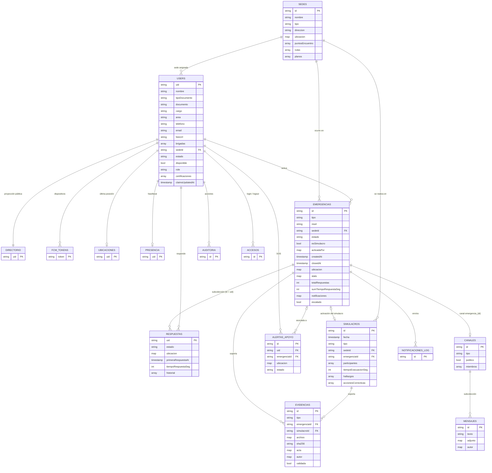

# Modelo de datos (Cloud Firestore)

Base documental: las relaciones se resuelven por **id de referencia** y por **desnormalización controlada** (por ejemplo, el nombre del brigadista se copia en su respuesta para que el tablero no tenga que hacer *joins*). Las marcas de tiempo críticas usan `serverTimestamp()` y las reglas exigen `createdAt == request.time`.

## 1. Diagrama entidad-relación



## 2. Colecciones y documentos

### `users/{uid}` — perfil completo del brigadista (datos personales)
| Campo | Tipo | Notas |
|---|---|---|
| nombre, tipoDocumento, documento, cargo, area | string | |
| telefono | string | E.164 recomendado (`+57…`) para SMS/WhatsApp |
| email | string | Solo lo escribe la Cloud Function |
| fotoUrl | string | Storage `usuarios/{uid}/…` |
| brigadas | string[] | `primeros_auxilios`, `evacuacion`, `contra_incendios`, `rescate` |
| sedeId | string | → `sedes` |
| estado | `activo` \| `inactivo` | `inactivo` deshabilita la cuenta en Auth (trigger) |
| disponible | bool | En turno; lo cambia el propio brigadista |
| role | string | Espejo de lectura del custom claim (no editable desde cliente) |
| certificaciones | `{nombre, entidad, fechaExpedicion, fechaVencimiento}[]` | Alerta diaria a 30 días |
| grupoSanguineo, contactoEmergencia | string | Información médica de emergencia |
| claimsUpdatedAt | timestamp | Señal para que el cliente refresque su token |

### `directorio/{uid}` — proyección sin datos sensibles
`nombre, cargo, area, brigadas, sedeId, fotoUrl, role, estado`. Mantenida por `onUserWritten`.

### `sedes/{id}` — centros de operación
`nombre, tipo (sede|edificio|planta|campus), direccion, responsable, telefono, ubicacion{lat,lng}, puntosEncuentro[{nombre, lat, lng, capacidad}], rutas[{nombre, descripcion}], planos[{nombre, url, path, contentType}], activa`.

### `emergencias/{id}`
| Campo | Escribe | Descripción |
|---|---|---|
| tipo, nivel, sedeId, sedeNombre, descripcion, ubicacion | cliente | |
| estado | cliente | `activa` → `cerrada` (no se reabre) |
| esSimulacro | cliente | `tipo == 'simulacro'` |
| activadaPor `{uid, nombre}` | cliente | Validado contra `request.auth.uid` |
| createdAt | servidor | `serverTimestamp` exigido por reglas |
| closedAt, cerradaPor, observacionesCierre | cliente | |
| stats `{recibido: n, en_desplazamiento: n, …}` | Function | Conteo por estado actual |
| totalRespuestas, respuestasConTiempo, sumTiempoRespuestaSeg | Function | Promedio = sum / con tiempo |
| notificaciones `{destinatarios, push, email, whatsapp, sms, escalamiento}` | Function | Resultado por canal |
| escalado, escaladoAt | Function | |

### `emergencias/{id}/respuestas/{uid}`
`uid, nombre, brigadas, telefono, estado, nota, ubicacion, updatedAt, clientAt, primeraRespuestaAt, primeraRespuestaClientAt, historial[{estado, at, lat, lng}], tiempoRespuestaSeg (servidor)`.
El id = uid garantiza **una respuesta por brigadista** y reglas simples.

### `alertasApoyo/{id}` — botón de pánico
`uid, nombre, telefono, sedeId, emergenciaId, mensaje, ubicacion, estado (abierta|atendida), prioridad, createdAt, atendidaPor, atendidaAt, notificaciones`.

### `ubicaciones/{uid}` — última posición conocida
`uid, nombre, sedeId, brigadas, lat, lng, accuracy, activa, clientAt, updatedAt`. Se escribe como máximo cada 20 s o al moverse > 20 m.

### `presencia/{uid}`
`uid, nombre, sedeId, lastSeen`. Heartbeat cada 2 min con la app visible → indicador «Conectados».

### `fcmTokens/{token}`
`uid, sedeId, platform, standalone, userAgent, updatedAt, topics[] (servidor)`.

### `simulacros/{id}`
`fecha, tipo, sedeId, emergenciaId, escenario, participantes[{uid, nombre}], totalParticipantes, poblacionEsperada, personasEvacuadas, tiempoAlertaSeg, tiempoEvacuacionSeg, tiempoObjetivoSeg, hallazgos[{tipo, descripcion}], accionesCorrectivas[{descripcion, responsable, fechaLimite, estado}], calificacion, creadoPor, createdAt`.

### `evidencias/{id}` — inmutables
`tipo (foto|video|documento|observacion|acta), emergenciaId, simulacroId, archivo{url, path, nombre, size, contentType}, sha256, observaciones, acta{fechaHora, lugar, personaAtendida, documentoAtendido, situacion, atencion, remision, responsable}, ubicacion, capturadaAt (hora del dispositivo), createdAt (servidor), autor{uid, nombre}, validada, validadaPor`.

### `canales/{id}` y `canales/{id}/mensajes/{id}`
Canal: `nombre, tipo (general|sede|emergencia|grupo|directo), publico, miembros[] (directos), nombres{}, emergenciaId, activo, ultimoMensaje, ultimoMensajeAt`.
Ids especiales: `emergencia_{emergenciaId}`, `dm_{uidA}_{uidB}` (ordenados).
Mensaje: `texto, adjunto{url, nombre, contentType}, esEvidencia, autor{uid, nombre, fotoUrl}, clientAt, createdAt`.

### Registros (append-only)
- `auditoria/{id}`: `accion, detalle, entidad{col, id}, uid, email, userAgent, online, standalone, createdAt`.
- `accesos/{id}`: `tipo (login|logout), uid, email, userAgent, standalone, createdAt`.
- `notificacionesLog/{id}`: `canal, status, count, failed, error, ref{col, id}, createdAt` (solo servidor).
- `_eventos/{eventId}`: control de idempotencia de triggers (configure **TTL** sobre `expireAt`).

## 3. Índices compuestos

Definidos en `firestore.indexes.json` y desplegados con `firebase deploy --only firestore:indexes`:

| Colección | Campos | Consulta que lo usa |
|---|---|---|
| emergencias | estado ↑, createdAt ↓ | Emergencias activas (OpsContext) |
| emergencias | esSimulacro ↑, createdAt ↓ | Importar simulacro |
| emergencias | sedeId ↑, createdAt ↓ | Historial por sede |
| alertasApoyo | estado ↑, createdAt ↓ | SOS abiertos |
| alertasApoyo | uid ↑, createdAt ↓ | SOS propios |
| evidencias | emergenciaId ↑, createdAt ↓ | Evidencias de una emergencia |
| evidencias | simulacroId ↑, createdAt ↓ | Evidencias de un simulacro |
| users | sedeId ↑, estado ↑ | Destinatarios por sede |
| users | estado ↑, disponible ↑ | Conteo de disponibles |
| users | role ↑, estado ↑ | Coordinadores activos (SOS, certificaciones) |
| ubicaciones | sedeId ↑, updatedAt ↑ | Mapa filtrado por sede |
| simulacros | sedeId ↑, fecha ↓ | Simulacros por sede |
| accesos | uid ↑, createdAt ↓ | Historial de accesos de un usuario |
| fcmTokens | uid ↑, updatedAt ↓ | Tokens de un usuario |

**Exenciones** (`fieldOverrides`): arreglos grandes que nunca se consultan (`respuestas.historial`, `users.certificaciones`, `simulacros.hallazgos/accionesCorrectivas`, `auditoria.detalle`) se excluyen de la indexación para ahorrar almacenamiento y costo de escritura.

## 4. Storage

```
usuarios/{uid}/foto_*.jpg            ≤ 5 MB, imágenes
evidencias/{emergenciaId|sim_x}/…    ≤ 150 MB, imagen/video/pdf/office · inmutable
chat/{canalId}/…                     ≤ 50 MB · inmutable
sedes/{sedeId}/…                     ≤ 30 MB, planos imagen/pdf
```
